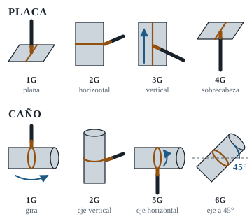

# 00 · Mapa del examen: qué te van a tomar

Antes de quemar un solo electrodo tenés que saber **contra qué regla te van a medir**. "Rendir AWS" se usa como nombre genérico, pero en la práctica hay tres códigos distintos, y cambian el cupón, la técnica y el ensayo.

---

## 1. Calificación vs. certificación

| Concepto | Qué es | Quién la da |
|---|---|---|
| **Calificación de soldador** (WPQ, *Welder Performance Qualification*) | Demostrás que podés hacer una soldadura sana siguiendo una WPS. Queda un registro con lo que soldaste y lo que te habilita. | El empleador o la entidad evaluadora, con un inspector que supervisa la prueba y los ensayos |
| **Certificación AWS** (programa *AWS Certified Welder*) | Credencial emitida por la American Welding Society | Solo los **Accredited Test Facilities (ATF)** acreditados por AWS. La prueba la supervisa un CWI con endoso de calificación de soldadores |
| **Certificado de curso** (por ejemplo, UOCRA) | Constancia oficial de que hiciste y aprobaste un curso de formación profesional | Centros de formación como los CIFIC/CFL de la Fundación UOCRA, con convenios provinciales |

**En Argentina:** la Fundación UOCRA dicta cursos de soldadura con certificación oficial en sus centros CIFIC/CFL (Morón, Pinamar, Salta, Chaco, Neuquén, entre otros). Por ejemplo, el CIFIC de Salta dicta "Soldadura por Arco para la Industria de la Construcción". **No encontré información pública de UOCRA sobre un examen con certificación AWS propiamente dicha.** Muchas obras califican soldadores con un inspector o con una consultora (como las que califican bajo ASME, AWS e ISO) usando la WPS de la empresa.
👉 **Preguntá en tu centro cuál es exactamente la prueba**. Abajo, en la sección 7, tenés la lista de preguntas.

---

## 2. Los tres códigos posibles

| Código | Dónde se usa | Prueba típica de caño con SMAW | Progresión | Ensayos |
|---|---|---|---|---|
| **AWS D1.1** (*Structural Welding Code – Steel*) | Estructuras metálicas, edificios, puentes y tubulares estructurales | Placa 3/8" o 1" con respaldo en 3G + 4G, o caño 6G (o 6GR para uniones T-Y-K) | Ascendente | Visual + doblado (la radiografía puede reemplazar al doblado) |
| **ASME Sección IX** (calificación para B31.1, B31.3, calderas y recipientes) | Cañerías de planta, industria, petroquímica, vapor y energía | Caño 6G, raíz E6010 + relleno E7018 (o todo E7018 con respaldo) | Casi siempre ascendente | Visual + doblado (QW-163) o radiografía (QW-191) |
| **API 1104** (*Welding of Pipelines and Related Facilities*) | Ductos: gasoductos, oleoductos y acueductos de acero | Caño fijo (5G o 6G), celulósicos E6010 / E7010 / E8010 | **Descendente** casi siempre | Visual + **nick-break** + doblado (tracción opcional para el soldador) |

> 💡 Si te vas a orientar a **gasoductos y oleoductos**, la técnica clave es la **descendente con celulósico**. Si vas a **planta, industria o construcción**, la clave es la **ascendente E6010/E7018**. Este temario entrena las dos, con foco en la ascendente, que es la más pedida en las pruebas 6G de ASME y AWS.

---

## 3. Posiciones

| Posición | Placa | Caño |
|---|---|---|
| **1G / 1F** | Plana: soldás desde arriba | Eje horizontal: el caño **gira** y soldás siempre arriba |
| **2G / 2F** | Horizontal: placa vertical, cordón horizontal | Eje **vertical**, caño fijo: cordones horizontales alrededor |
| **3G / 3F** | Vertical (ascendente o descendente) | – |
| **4G / 4F** | Sobrecabeza: soldás por debajo | – |
| **5G** | – | Eje **horizontal**, caño fijo: de abajo (sobrecabeza) hasta arriba (plano) |
| **6G** | – | Eje a **45°**, caño fijo: combina todo. Es la prueba "reina" |
| **6GR** | – | 6G con anillo restrictor (AWS D1.1, uniones tubulares T-Y-K) |

**Qué te habilita cada prueba (resumen):**

- **6G** te califica para **todas las posiciones**, en ranura y filete, de caño y de placa, tanto en AWS D1.1 como en ASME IX, siempre dentro de los límites de diámetro y espesor. Por eso es la prueba más buscada.
- En **ASME IX**, aprobar **2G + 5G** por separado equivale a 6G.
- En placa, **3G + 4G** es la combinación clásica de D1.1 para estructuras en todas las posiciones.
- ⚠️ Las tablas exactas son ASME QW-461.9 y la tabla de posiciones calificadas de D1.1 (Tabla 6.10 en la edición 2020; la numeración puede cambiar en 2025).

> 📄 **En tus PDF:** curso M381, págs. 21 a 26: posiciones en placa, en filete y en caño, con dibujos (en inglés).

[Ver en YouTube: posiciones de soldadura 1G a 6G](https://www.youtube.com/results?search_query=posiciones+de+soldadura+1G+2G+3G+4G+5G+6G)

---

## 4. Rangos que te habilita la prueba

### ASME IX

| Variable | Regla | Ejemplo |
|---|---|---|
| **Diámetro** (QW-452.3) | Cupón de diámetro exterior < 1": califica ese diámetro como mínimo. Entre 1" y menos de 2⅞": califica desde 1". De 2⅞" (73 mm) en adelante: califica desde 2⅞" sin máximo | Cupón de 6" → habilita desde 2⅞" (73 mm) en adelante |
| **Espesor depositado** (QW-452.1(b)) | Si depositás t ≥ 13 mm (½") con al menos 3 capas, el máximo es ilimitado. Si no, el máximo es 2t | 6" Sch 80 (10,97 mm) → hasta unos 22 mm |
| **Metal de aporte** (F-Number, QW-432/433) | E6010 = F3, E7018 = F4 | Con raíz 6010 sin respaldo + relleno 7018 quedás habilitado para esa combinación. La interpretación exacta la hace el inspector según QW-433 |
| **Progresión** (QW-405.3) | Cambiar de ascendente a descendente (o al revés) exige recalificar | La raíz ascendente no te habilita para descendente |
| **Respaldo** (QW-402.4) | Calificar sin respaldo habilita con y sin respaldo; con respaldo habilita solo con respaldo | Por eso la prueba de caño es de raíz abierta |

**Variables esenciales del soldador SMAW** (ASME QW-353): respaldo, diámetro del caño, P-Number del metal base, F-Number del electrodo, espesor depositado, posición y progresión vertical. Si cambia alguna, se recalifica.

### AWS D1.1 ⚠️ verificar contra la edición vigente

| Cupón de prueba | Califica (resumen) |
|---|---|
| Placa 3/8" (10 mm) | Espesor limitado: hasta unos 3/4" (2t) |
| Placa 1" (25 mm) | Espesor ilimitado |
| Caño 2" Sch 80 o 3" Sch 40 | Diámetros chicos: aproximadamente de 3/4" a 4" |
| Caño 6" Sch 120 u 8" Sch 80 | 4" y mayores, espesor ilimitado (mínimo 3/16") |

---

## 5. Cómo te evalúan

### Paso 1: inspección visual (si no pasa, ni se corta)

Criterios típicos para la prueba de soldador en **AWS D1.1** (cláusula 6, Parte C, edición 2020) ⚠️:

- **Ninguna fisura** de ningún tamaño.
- **Todos los cráteres llenos** en toda la sección.
- **Socavación** ≤ 1/32" (≈ 1 mm).
- **Sobremonta** (refuerzo de cara) ≤ 1/8" (3 mm), con transición suave al metal base.
- **Raíz** (caño sin respaldo): penetración completa, sin fisuras ni falta de fusión. La **concavidad de raíz** es ≤ 1/16" (≈ 2 mm) y el **exceso de penetración** (*melt-through*) ≤ 1/8" (3 mm).

**ASME IX** (QW-302.4): el cupón de caño tiene que mostrar penetración completa de la junta con fusión completa entre metal de soldadura y metal base. En general es menos estricto en lo visual que D1.1, pero **igual practicá contra los límites de D1.1**. Si cumplís esos, cumplís cualquiera.

**Rechazos "tontos" que te pueden dejar afuera:**

- Golpes de arco fuera de la junta.
- Cráter sin llenar.
- Presentación amolada cuando no estaba permitido.
- Cupón enfriado con agua.
- Posición mal armada (por ejemplo, 6G que no está a 45° ± 5°).

### Paso 2: ensayos

> 📄 **En tus PDF:** curso M381, págs. 37 a 44: cómo se inspecciona una soldadura (visual, tintas penetrantes, partículas magnéticas, radiografía y ultrasonido).

| Ensayo | Qué es | Cuántas probetas (5G/6G) | Criterio de aceptación |
|---|---|---|---|
| **Doblado guiado** (ASME / D1.1) | Se corta una tira, se amola al ras y se dobla en U con un mandril | 4 probetas: **2 de cara + 2 de raíz** si el espesor es < 10 mm (3/8"), o **4 laterales** si es ≥ 10 mm ⚠️ | **ASME QW-163:** ninguna discontinuidad abierta > 3 mm (1/8") en soldadura o zona afectada por el calor (ZAC). **D1.1:** ninguna discontinuidad > 3 mm en cualquier dirección, la suma de las mayores de 1 mm a 3 mm no puede superar 10 mm (3/8"), y las fisuras de esquina pueden llegar a 6 mm (1/4") ⚠️ |
| **Nick-break** (API 1104) | Se ranura la probeta a los costados y se rompe para mirar el interior | Según diámetro y espesor (tabla de la norma) | Penetración y fusión completas. Poro máximo de 1/16" (1,6 mm). Límites para inclusiones de escoria ⚠️ |
| **Doblado API 1104** | Como el anterior | Según tabla | Sin fisuras ni imperfecciones mayores a 1/8" (3 mm) o a la mitad del espesor nominal, lo que sea menor |
| **Radiografía (RT)** | Placa radiográfica de toda la soldadura | Toda la circunferencia | Puede **reemplazar al doblado** en ASME y D1.1 (en D1.1, salvo GMAW de cortocircuito) |

> 📌 **Dato útil:** un 6" Sch 80 tiene 10,97 mm de pared, así que lleva **doblados laterales**. Un 4" Sch 80 (8,56 mm) lleva **cara y raíz**. Según el caño del examen, practicá el ensayo que corresponda (capítulo 08).

> 📌 **Dónde fallan la mayoría:** en el **doblado**, casi siempre por **falta de fusión** en los pies del cordón o en la raíz. La falta de fusión no se ve desde afuera. Por eso el capítulo 08 insiste en que dobles y rompas tus propias probetas.

---

## 6. La prueba más probable (escenario base de este temario)

| Ítem | Escenario típico |
|---|---|
| Material | Caño de acero al carbono (ASTM A106 Gr. B / API 5L Gr. B o similar, P-No. 1) |
| Diámetro y espesor | 4" Sch 80, 6" Sch 80 o 6" Sch 120 / 8" Sch 80 si es "ilimitado" |
| Junta | V simple, bisel de 37,5° ± 2,5°, talón 1,6 mm ± 0,8, luz 2,4 a 3,2 mm |
| Posición | 6G (a 45°), fija |
| Raíz | E6010 de 2,5 mm o 3,2 mm, ascendente |
| Pase caliente | E6010 3,2 mm o E7018 2,5 mm (según WPS) |
| Relleno y presentación | E7018 de 2,5 mm y/o 3,2 mm, ascendente |
| Ensayo | Visual + 4 doblados (o RT) |

---

## 7. Preguntas que tenés que hacer ANTES de inscribirte

Copiá esta lista y llevala:

- [ ] ¿Qué **código y edición**? (AWS D1.1, ASME IX, API 1104)
- [ ] ¿Me pueden dar o mostrar la **WPS**?
- [ ] ¿**Material, diámetro y espesor** del cupón?
- [ ] ¿El **bisel viene hecho** o lo preparo yo? ¿Con qué herramientas y en cuánto tiempo?
- [ ] ¿**Posición** (6G, 6GR, 2G + 5G, placa 3G/4G)? ¿**Progresión** ascendente o descendente?
- [ ] ¿Qué **electrodos** (marca y diámetro)? ¿Los proveen ellos? ¿Hay horno para el 7018?
- [ ] ¿Qué **máquina**? ¿Puedo probarla en un retazo antes de empezar?
- [ ] ¿Se puede **amolar**? ¿Entre pasadas, en la raíz, en arranques y paradas? ¿En la presentación?
- [ ] ¿Dónde van los **puntos** de armado? ¿Tienen que quedar dentro del bisel? ¿Los aprueba el inspector?
- [ ] ¿Cuánto **tiempo** hay? ¿Puedo **cambiar de posición** el cuerpo libremente? ¿Hay obstáculos?
- [ ] ¿Qué **ensayo** se hace: doblado, radiografía o nick-break?
- [ ] ¿Hay **parte teórica** (lectura de planos, simbología, WPS)?
- [ ] ¿Cuántos **intentos** hay y cuánto hay que esperar si desapruebo?
- [ ] ¿Qué **EPP** tengo que llevar?
- [ ] ¿Qué credencial me dan, quién la emite y cuánto dura (continuidad, revalidación)?

> En ASME IX y AWS D1.1, la calificación se mantiene mientras sueldes con el proceso. Si pasás **6 meses sin usarlo**, caduca. Preguntá cómo se registra tu continuidad.
