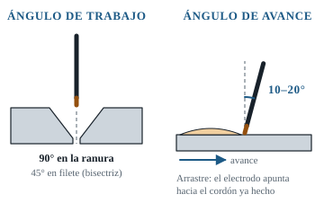

# 02 · Equipo, electrodos y parámetros

---

## 1. Conocé tu máquina (lo primero que tenés que averiguar)

Mirá la chapa de características (la etiqueta) de tu soldadora y anotá:

| Dato | Dónde se ve | Por qué importa |
|---|---|---|
| **Tipo de corriente**: AC, DC o AC/DC | Símbolo `~` (alterna) o `⎓` (continua) | El **E6010 solo funciona en continua (DC+)**. Con un transformador AC no vas a poder correr 6010 |
| **Tensión en vacío (OCV, U₀)** | "U₀ = xx V" | Los celulósicos (6010/6011) necesitan una OCV alta. En foros de soldadores se citan **60 a 70 V o más** para que corran bien. Muchos inversores chicos no llegan |
| **Rango de amperaje y ciclo de trabajo** | "I₂ 10–200 A", "X 60% @ 160 A" | Para caño vas a trabajar entre 60 y 140 A. Un ciclo de trabajo bajo hace que la máquina corte por temperatura en medio de la raíz |
| **Funciones del inversor** | Perillas o menú | **Arc force** (fuerza de arco): imprescindible para 6010. **Hot start**: ayuda en el arranque. **Anti-stick**. Algunos equipos tienen modo **"CEL" / "6010"** |

### Prueba rápida: ¿tu máquina corre 6010?

1. Polaridad **DC+** (pinza al **+**, masa al **–**).
2. Electrodo E6010 de 3,2 mm, a 80–90 A, sobre una chapa de 10 mm en **vertical ascendente**.
3. Acortá el arco hasta casi "enterrar" el electrodo.

- **Bien:** el arco se mantiene con un sonido "rasposo" y cortante, y penetra.
- **Mal:** el arco se corta cuando lo acortás, el electrodo se pega a cada rato o el arco "se apaga" al alargarlo apenas.

[Ver en YouTube: electrodo 6010 con inversor](https://www.youtube.com/results?search_query=electrodo+6010+inversor)

**Si tu máquina no corre 6010:**

- **Plan A:** subí el arc force al máximo o probá el modo CEL si lo tiene.
- **Plan B:** practicá la raíz con **E6011**, que es celulósico, funciona en AC y DC y tiene un comportamiento parecido. Pasate al 6010 en una máquina prestada o en el centro en las últimas semanas antes del examen.
- **Plan C:** si vas a comprar máquina, buscá un inversor o rectificador **apto celulósicos** (que lo diga explícitamente) con arc force regulable.

> ⚠️ El E7018 también exige una máquina con buen arranque. En AC, muchos transformadores chicos lo corren mal. Si tu equipo es solo AC, consultá si existe la versión AC del 7018 de tu marca.

### Polaridad

| Electrodo | Polaridad | Detalle |
|---|---|---|
| E6010 | **DC+ (DCEP)**: pinza al positivo | Únicamente DC+ |
| E6011 | AC o DC+ | Alternativa si solo tenés AC |
| E7018 | DC+ (preferido) o AC | En caño, siempre DC+ |
| E6013 | AC, DC+ o DC– | No se usa en la prueba de caño |

### Cables y masa

- Masa **sobre el cupón** o muy cerca, en metal limpio y amolado. Una masa floja da un arco inestable y empeora el soplo magnético (capítulo 06).
- Cables de buena sección y lo más cortos posible. Desenrollados: un cable enrollado en bobina mete inductancia y calienta.
- **Amperímetro de pinza:** el dial de muchas máquinas no coincide con la corriente real. Si podés, medí una vez para saber cuánto "miente" tu equipo.

---

## 2. Clasificación AWS A5.1 del electrodo (lo tenés que saber de memoria)

```
        E  70  1  8  -1  H4R
        │  │   │  │   │   └─ Sufijos opcionales: H4/H8/H16 = hidrógeno difusible máx. (ml/100 g)
        │  │   │  │   │                         R = resistente a la absorción de humedad
        │  │   │  │   └──── -1 = requisitos mejorados de tenacidad (impacto)
        │  │   │  └──────── Junto con el anterior: tipo de revestimiento y corriente
        │  │   └─────────── Posición: 1 = todas · 2 = plano y filete horizontal · 4 = vertical descendente (E7048)
        │  └─────────────── Resistencia mínima a la tracción en ksi (60 ≈ 430 MPa · 70 ≈ 490 MPa)
        └────────────────── Electrodo
```

**Los dos últimos dígitos** (revestimiento y corriente):

| Dígitos | Revestimiento | Corriente | Comportamiento |
|---|---|---|---|
| **10** | Celulósico sódico | DC+ | Arco muy penetrante y "excavador", poca escoria. **El rey de la raíz** |
| **11** | Celulósico potásico | AC / DC+ | Parecido al 10, apto para AC |
| 12 | Rutílico sódico | AC / DC– | Penetración media |
| **13** | Rutílico potásico | AC / DC± | Suave y prolijo, poca penetración. Herrería y chapa fina |
| **18** | **Básico (bajo hidrógeno)** con polvo de hierro | AC / DC+ | Metal de soldadura tenaz y sano. **Relleno y presentación en caño** |
| 24, 27, 28 | Con polvo de hierro (alta deposición) | Varias | Solo plano y horizontal. No se usan en caño |

> 📄 **En tus PDF:** curso M381, págs. 58 y 59: clasificación de electrodos AWS y qué significa cada terminación (en inglés).

### Equivalencias de marcas habituales en Argentina

| AWS | ESAB Conarco | Lincoln | Uso en este temario |
|---|---|---|---|
| E6010 | **Conarco 10** (apto para cañerías y pase de raíz, según la hoja técnica ESAB) | Fleetweld 5P+ / Pipeliner 6P+ | Raíz y pase caliente |
| E7018-1 | **Conarco 18** (básico con polvo de hierro y bajo hidrógeno) | Excalibur 7018 | Relleno y presentación |
| E6013 | Conarco 13A | Fleetweld 37 | Chapa fina y herrería (no es para el examen) |

> Usá en la práctica **la misma marca y diámetro que vas a usar en el examen**. Cada marca de 6010 "corre" distinto (ancho de ojo, fluidez, escoria).

---

## 3. Parámetros de partida

Son **puntos de partida**: después ajustás por máquina, posición, espesor y por cómo se ve el charco. Los rangos salen de hojas técnicas de fabricantes y de WPS típicas.

| Electrodo | Ø | Rango del fabricante | **Raíz ascendente** | **Pase caliente** | **Relleno y presentación ascendente** | Plano |
|---|---|---|---|---|---|---|
| E6010 | 2,5 mm (3/32") | ~40–85 A (varía por marca) | **55–70 A** | – | – | 60–80 A |
| E6010 | 3,2 mm (1/8") | ~75–125 A | **75–95 A** | 95–115 A | – | 90–120 A |
| E6010 | 3,2 mm descendente (API) | – | 90–120 A ⚠️ | 110–130 A ⚠️ | – | – |
| E7018 | 2,5 mm (3/32") | **70–90 A** (Conarco 18) | – | 75–85 A | **75–90 A** | 85–95 A |
| E7018 | 3,2 mm (1/8") | **100–140 A** (Conarco 18) | – | – | **100–120 A** | 120–140 A |
| E7018 | 4,0 mm (5/32") | **130–170 A** (Conarco 18) | – | – | Rara vez en caño | 140–170 A |

**Reglas de ajuste:**

- **Sobrecabeza y vertical:** entre 5 y 15 % menos que en plano. En la práctica, en 5G/6G se trabaja con un valor intermedio que funcione en toda la vuelta, y se compensa con velocidad y ángulo.
- **Espesor chico (Sch 40):** bajá entre 5 y 10 A.
- **Cupón muy caliente** (después de varias pasadas): el charco se vuelve más fluido. Bajá 5 A o andá más rápido.
- **Señales de amperaje alto:** el electrodo se pone al rojo antes de la mitad, el charco "chorrea", hay socavación y el ojo de la raíz crece sin control.
- **Señales de amperaje bajo:** el electrodo se pega, el cordón queda alto y angosto, hay escoria atrapada y falta de fusión en los costados.

---

## 4. Longitud de arco y ángulos

**Longitud de arco**

- **E6010:** arco **corto**. En la raíz, la punta va prácticamente **apoyada o "enterrada"** en la junta, empujando.
- **E7018:** arco **corto y constante**, igual o menor al diámetro del alma. **Si alargás el arco con 7018, aparece porosidad**, porque el revestimiento básico protege solo con arco corto.

**Ángulos** (se miden siempre respecto de la pieza):



- **Arrastre (drag):** el electrodo está inclinado hacia el cordón ya depositado. Es lo normal en plano, con 6010 descendente y con 7018 en general.
- **Empuje (push):** el electrodo apunta hacia adelante. En la **raíz ascendente** del caño se trabaja casi perpendicular o con un leve ángulo hacia arriba, según la zona del reloj (capítulo 06).

---

## 5. Almacenamiento y cuidado de electrodos

### E7018 (bajo hidrógeno): crítico

El revestimiento básico **absorbe humedad del aire**. Un 7018 húmedo produce **porosidad** y riesgo de **fisuración por hidrógeno**. En el examen, el inspector se fija en esto.

Referencia de AWS D1.1 para electrodos de bajo hidrógeno ⚠️ (verificá la edición vigente y la hoja del fabricante, que manda):

| Paso | Requisito de referencia |
|---|---|
| Al abrir la lata | Pasar los electrodos directo a un **horno de mantenimiento a ≥ 120 °C (250 °F)** |
| Exposición al aire | E70XX: máximo **4 horas** fuera del horno. Para E70XX-R hay más margen |
| Resecado (si se pasó el tiempo) | **260 a 430 °C (500 a 800 °F) durante al menos 2 h** para electrodos A5.1. **Una sola vez** |
| Electrodos mojados | **No se usan** |

**En tu taller:**

- Comprá el 7018 en **latas o envases herméticos chicos** y abrí solo lo que vas a usar.
- Un **termo portaelectrodos** (horno portátil chico) es una buena inversión si vas en serio.
- Alternativa casera: un horno eléctrico viejo, **que no se use para comida**, a unos 120 °C como horno de mantenimiento, con un termómetro de verdad.
- Si un 7018 húmedo te da porosidad, aprendé a reconocerla, pero **no te acostumbres a soldar así**.

### E6010 (celulósico): al revés

- **No se secan en el horno.** El revestimiento celulósico necesita su humedad natural para funcionar. Secarlo lo arruina: el arco se vuelve inestable y "quema" el revestimiento.
- Guardalos en su lata cerrada, en un lugar seco y a temperatura ambiente.
- Si se mojaron (lluvia, agua), descartalos.

### Revisá cada electrodo

- Revestimiento **sin fisuras, descascarados ni humedad**, y bien centrado. Si un electrodo "hace pipa" (el arco se desvía de un lado), puede estar excéntrico: descartalo.
- Punta del 7018 a medio usar: el cráter de revestimiento que queda en la punta dificulta el reencendido. Limpiala con un toque en la chapa o con la uña de la piqueta antes de reiniciar.

---

## 6. Arranques: dónde y cómo encender el arco

- **Siempre dentro de la junta**, o sobre el cordón anterior. **Nunca en el caño fuera del bisel.** Un "golpe de arco" fuera de la junta es un defecto rechazable y un punto de inicio de fisuras.
- **E6010:** arranque por raspado ("como un fósforo") dentro del bisel o sobre el punto de armado.
- **E7018:** el primer centímetro sale "frío" y con riesgo de **porosidad de arranque**. Técnica: **encendé 10 a 15 mm adelante** del punto de inicio, dentro de la junta, **volvé** al punto de arranque con arco corto y recién ahí empezá a avanzar. Así refundís la zona donde encendiste.
- Practicá encender en un círculo de 5 mm dibujado con tiza. Es un ejercicio de 5 minutos por día que te ahorra muchos rechazos.

[Ver en YouTube: cómo encender el arco con 7018](https://www.youtube.com/results?search_query=c%C3%B3mo+encender+el+arco+electrodo+7018)
