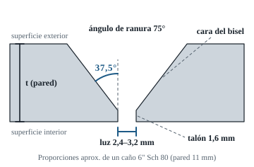
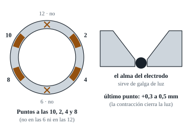
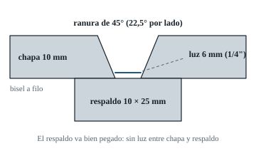

# 04 · Preparación de material

Una raíz sana empieza en el bisel. **Con mala preparación, ni el mejor soldador hace una raíz pareja.** En muchos exámenes te dan el cupón ya biselado, pero en obra, y en algunas pruebas, lo preparás vos. Y para practicar en casa lo vas a hacer todas las semanas.

---

## 1. Material para practicar

### Caño

- **Acero al carbono sin costura:** ASTM A106 Gr. B, API 5L Gr. B o A53 Gr. B. Es el P-No. 1, el mismo grupo que el de los exámenes típicos.
- **Dónde conseguirlo:** recortes en distribuidores de cañería, chatarrerías industriales, obras y talleres de *piping*. Pedí "recortes de caño Sch 80".
- **Qué diámetros:**
  - **4" Sch 40** (6 mm) para empezar con raíces (más barato y más rápido).
  - **4" Sch 80** (8,56 mm) y **6" Sch 80** (10,97 mm) para pruebas completas.
  - Si te van a tomar en **2"**, practicá en 2" Sch 80: el radio chico cambia todo.
- **Evitá:** galvanizado, caño con costura en espiral de pared fina e inoxidable.

### Placa (chapa)

- **Acero estructural** tipo ASTM A36 o equivalente local, de 10 mm (3/8") y, si podés, de 25 mm (1").
- **Planchuela de 10 × 25 mm** para respaldo.

### Cantidades orientativas (16 semanas, capítulo 09)

| Material | Cantidad aproximada | Nota |
|---|---|---|
| Chapa de 10 mm | 25–30 kg | Cortada en tiras de 75–150 mm de ancho |
| Caño 4" Sch 40/80 | 2–3 m | Cupones de 100–150 mm de largo. Se reutilizan |
| Caño 6" Sch 80 | 2–3 m | Ídem |
| E6010 (2,5 y 3,2 mm) | 12–18 kg | |
| E7018 (2,5 y 3,2 mm) | 30–40 kg | |
| Discos de corte de 115 × 1 mm | 30–40 | |
| Discos de desbaste de 115 × 6 mm | 15–20 | |
| Discos flap grano 40/60 | 15–20 | |
| Discos finos de 115 × 3 mm (para limpiar raíz y empalmes) | 10–15 | Imprescindibles |
| Cepillo de copa de alambre trenzado | 3–4 | Para limpiar escoria entre pasadas |

---

## 2. Herramientas (con amoladora y poco más)

**Imprescindibles:**

- Amoladora de 115 mm y, si podés, una segunda para no cambiar discos todo el tiempo: una con disco fino y otra con flap o cepillo.
- Piqueta, cepillo de alambre de mano y lima plana bastarda.
- Escuadra metálica, regla y cinta métrica.
- **Tiza de soldador o lápiz de jabón** y punta de trazar.
- **Plantilla "wrap-around"** para marcar cortes rectos en caño: una tira de cartulina, chapa fina o cinta de lija ancha que envuelva el caño.
- Morsa o sargentos.
- **Galgas:** de filete, de luz y de desalineación (hi-lo). Una galga multifunción tipo *Cambridge/Bridge Cam* es útil. **Galga de luz casera:** el alma de un electrodo de 2,5 mm sin revestimiento sirve como galga de 2,5 mm, y uno de 3,2 mm como galga de 3,2 mm.
- **Transportador** o una **plantilla de chapa cortada a 37,5°** para controlar el bisel.
- Un **nivel o un inclinómetro** (alcanza una app del celular) para armar el 6G a 45°.
- Espejo chico y linterna para revisar la raíz por dentro.

**Muy recomendables:**

- **Soporte de posiciones** (ver sección 8).
- Termo portaelectrodos u horno para el 7018.
- **Lápices termoindicadores** (tizas que se derriten a una temperatura dada) o un termómetro infrarrojo, para controlar la temperatura entre pasadas.

---

## 3. Corte a escuadra del caño

1. Envolvé el caño con la plantilla *wrap-around*, que tiene que quedar **tensa y con el borde coincidiendo consigo mismo** al dar la vuelta.
2. Marcá la línea con tiza o punta de trazar.
3. Cortá con disco de 1 mm, girando el caño o rodeándolo, **siguiendo la línea**. No intentes cortar de un lado al otro de una pasada.
4. Controlá con la escuadra en 4 puntos (12, 3, 6, 9). Objetivo: **fuera de escuadra ≤ 1 mm**. Si no, emparejá con el flap.

---

## 4. Biselado con amoladora (paso a paso)



### Cuánto bisel marcar

El ancho del bisel, medido sobre la superficie exterior desde el extremo del caño, es:

```
  ancho del bisel = (t − talón) × tan(37,5°)  ≈  (t − 1,6) × 0,767
```

| Caño | Pared t | Ancho del bisel a marcar |
|---|---|---|
| 2" Sch 80 | 5,54 mm | ≈ 3,0 mm |
| 4" Sch 40 | 6,02 mm | ≈ 3,4 mm |
| 4" Sch 80 | 8,56 mm | ≈ 5,3 mm |
| 6" Sch 80 | 10,97 mm | ≈ 7,2 mm |
| 6" Sch 120 | 14,27 mm | ≈ 9,7 mm |
| 8" Sch 80 | 12,70 mm | ≈ 8,5 mm |

Para placa de 10 mm con bisel de 30° (ranura de 60°): `(10 − 1,6) × 0,577 ≈ 4,8 mm`.

### Procedimiento

1. **Marcá** una línea a esa distancia del borde con la plantilla *wrap-around*. Marcá también, en el **canto**, la línea del talón (a 1,6 mm de la cara interior).
2. **Desbaste:** disco de desbaste o flap grano 40, con la amoladora inclinada a unos 37° respecto del eje del caño. Trabajá **de a sectores** y girá el caño. **No intentes sacar todo en una pasada.** Varias pasadas parejas dan un ángulo constante.
3. **Terminación:** flap grano 60/80, controlando con la plantilla de 37,5°. Tolerancia: **± 2,5°**. La cara del bisel tiene que quedar **plana**, no "redondeada".
4. **Talón:** dejá un talón parejo de **1,6 mm (1,2 a 2,0 mm)** en toda la vuelta. Método práctico: apoyá el caño parado y pasá **lima plana** por el canto, o pasá el flap a plano contra el extremo.
   - **Talón irregular = raíz irregular.** Donde el talón es grueso falta penetración. Donde es fino, se cae o perfora.
5. **Limpieza:** dejá **metal brillante 25 mm** hacia afuera del bisel, por dentro y por fuera (con flap o cepillo). Sin óxido, cascarilla, pintura, aceite ni humedad.
6. **Rebaba interior:** sacá el filo o rebaba de la cara interior con lima o flap, sin redondear el talón.

[Ver en YouTube: biselar caño con amoladora](https://www.youtube.com/results?search_query=biselar+ca%C3%B1o+con+amoladora+37.5)

> ✅ **Control final:** ángulo 35° a 40°, talón de 1,2 a 2,0 mm parejo en toda la vuelta, extremo a escuadra y zona limpia.

---

## 5. Presentación (armado de la junta)

### Alinear

Truco clásico: apoyá los dos caños sobre un **perfil ángulo** puesto "en V" sobre la mesa (o sobre dos ángulos paralelos). Los caños quedan solos, alineados y coaxiales.

### Luz (abertura de raíz)

- **Regla:** luz ≈ diámetro del alma del electrodo de raíz.
  - E6010 de 2,5 mm → luz de **2,4 a 2,5 mm**.
  - E6010 de 3,2 mm → luz de **2,5 a 3,2 mm**.
- **Usá el alma pelada del electrodo como galga.** Ponela en la luz, apretá y punteá.
- **Compensá la contracción:** cada punto, al enfriarse, **cierra la luz**. Dejá el último punto (el opuesto al primero) con **0,3 a 0,5 mm más** de luz.

**Relación luz / talón:**

| Combinación | Resultado | Cómo compensar con la técnica |
|---|---|---|
| Luz grande + talón fino | Exceso de penetración, perforación, "carámbanos" | Más latigueo, más velocidad y menos amperaje |
| Luz chica + talón grueso | Falta de penetración | Empujar más el electrodo, más amperaje y menos latigueo |
| Luz pareja + talón parejo | Raíz pareja | **Es lo que buscás** |

### Desalineación (hi-lo)

- Medí en 4 puntos con la galga o con una regla apoyada en el exterior.
- **Objetivo: 0 mm. Máximo: 1,6 mm (1/16")** ⚠️ (los límites de obra los da el código o la WPS).
- Si hay ovalización, ubicá el "alto" de un caño contra el "alto" del otro, girándolo, para repartir la diferencia.

---

## 6. Punteado



| Caño | Cantidad de puntos | Ubicación sugerida (reloj) | Largo de cada punto |
|---|---|---|---|
| 2" | 2–3 | 10, 2 (y 6 si hace falta) | 6–10 mm |
| 4" | 3–4 | 10, 2, 4, 8 | 10–15 mm |
| 6"–8" | 4 | 10, 2, 4, 8 | 15–20 mm |

- Para 5G y 6G, **evitá puntear en las 6 y en las 12**. Ahí arrancás y cerrás la raíz, y un punto en ese lugar complica el inicio.
- **Punteá con el mismo electrodo de la raíz (E6010) y con penetración completa.** Un punto es un pedacito de raíz: tiene que quedar sano.
- **Afilá ("feather") ambos extremos** de cada punto con el disco fino, dejándolos en rampa. Así, al llegar con la raíz, el empalme se funde sin escalón.
- Revisá que ningún punto esté fisurado. Si lo está, **amolalo y rehacelo**.
- **Puntos "puente"** (pequeñas planchuelas soldadas por fuera que unen ambos caños): **solo si el examen lo permite**. En la mayoría de las pruebas los puntos van **dentro del bisel**. Preguntá.

[Ver en YouTube: armado y punteado de tubería](https://www.youtube.com/results?search_query=armado+y+punteado+de+tuber%C3%ADa+luz+de+ra%C3%ADz)

---

## 7. Montaje en posición

- **2G:** el caño con el eje vertical. La junta queda horizontal, a la **altura del pecho o de los hombros**.
- **5G:** eje horizontal, a una altura que te permita trabajar la parte de abajo (las 6) **sin acostarte del todo**: arrodillado o sentado en un banquito.
- **6G:** eje a **45° ± 5°**. **Controlalo con el inclinómetro.** Marcá la línea de las 12 con tiza.
- **Fijalo bien:** el cupón **no puede girar ni moverse**. En el examen, mover el cupón de posición durante la soldadura es motivo de rechazo.
- **Masa** sobre el cupón, en metal limpio.
- **Antes de encender, hacé un "recorrido en seco"** con el electrodo apagado de las 6 a las 12. Si en algún punto no llegás o no ves el bisel, acomodá la altura o tu cuerpo. Es mejor descubrirlo antes que a mitad de la raíz.

---

## 8. Soporte de posiciones casero

```
            brazo horizontal (caño 2" o perfil), con agujeros cada 50 mm
          ┌────────────────────────────┐
          │   ╔════╗ ← abrazadera o mordaza que sujeta el cupón
          │   ║cupón║   (se fija con un perno que permite girarlo a 0°, 45° y 90°)
          │   ╚════╝
          │
  poste   ║  ← caño de 3" con perno pasante para regular la altura (cada 100 mm)
 vertical ║
          ║
    ══════╩══════  ← base pesada: chapa de 12–20 mm de 500 × 500 mm, o una llanta de camión con hormigón
```

- **Altura regulable** de 0,5 m a 1,6 m.
- **Rótula o placa con agujeros a 0°, 45° y 90°** para pasar de 2G a 5G y a 6G sin desarmar.
- El soporte tiene que ser **rígido**: si vibra al apoyar la mano, no sirve.
- Para placa (3G/4G), soldá una "oreja" de planchuela al cupón y abulonala o sujetala al brazo.

[Ver en YouTube: soporte para practicar soldadura en posición](https://www.youtube.com/results?search_query=soporte+posicionador+para+practicar+soldadura+casero)

---

## 9. Cupones de placa

### Ranura con respaldo (tipo prueba AWS D1.1) ⚠️ verificar con la WPS o figura del examen



- Dos chapas de 10 × ~75–150 × ~150–200 mm, con bisel de 22,5° **sin talón** (filo), luz de 6 mm y respaldo de 10 × 25 mm.
- Punteá el respaldo **por el lado de abajo y en los extremos**, de modo que **no quede luz** entre la chapa y el respaldo (si queda luz, la escoria se mete ahí).
- Dejá **20 a 25 mm sobrantes** en cada extremo: ahí arrancás y terminás, y después se descartan al cortar las probetas.

### Raíz abierta en placa (paso previo al caño)

- Chapa de 10 mm con bisel de 30° a 37,5°, talón de 1,6 mm y luz de 2,5 a 3,2 mm, **sin respaldo**.
- Es el mejor ejercicio para dominar el "ojo" de la raíz antes de pasar al caño.
- Usalo en 3G (vertical ascendente), 4G (sobrecabeza) y 2G.

---

## 10. Reutilizar material (ahorro grande)

- **Caño:** después de soldar y evaluar, **cortá la soldadura** con disco de 1 mm, a ambos lados, y **rebiselá**. Cada tramo de caño te da varias juntas.
- **"Anillos" para raíz:** si solo practicás la raíz, usá cupones cortos (50 a 75 mm por lado). Después de cortar la raíz para revisarla, rebiselás.
- **Placa:** las tiras de ranura con respaldo, una vez cortadas para las probetas, sirven como material de práctica de filetes y *padding*.
