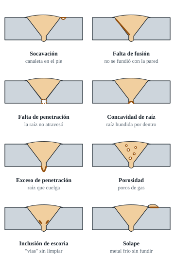

# 07 · Defectos: causas y soluciones

"Discontinuidad" es cualquier interrupción en la soldadura. Se convierte en **"defecto"** cuando supera el límite del código. En el examen no te preguntan el nombre: **te rechazan el cupón**. Aprendé a reconocer cada una y a saber por qué apareció.

> 📄 **En tus PDF:** curso M381, págs. 37 a 44: inspección y ensayos no destructivos, con los defectos que detecta cada método.

[Ver en YouTube: defectos de soldadura: causas y soluciones](https://www.youtube.com/results?search_query=defectos+de+soldadura+causas+y+soluciones)

---

## 1. Tabla maestra (SMAW, caño y placa)

| Defecto | Cómo se ve o se detecta | Causas típicas en SMAW | Corrección | ¿Rechaza? |
|---|---|---|---|---|
| **Fisura** | Línea fina en el cordón, el cráter o la zona afectada por el calor (ZAC). Se abre en el doblado | Cráter sin llenar, 7018 húmedo (hidrógeno), enfriamiento brusco o cordón muy chico en pieza gruesa | Llenar cráteres. Electrodos secos. No enfriar con agua. Precalentar si hace frío | **Siempre**, de cualquier tamaño |
| **Falta de fusión** (en pared o entre pasadas) | No se ve desde afuera. **Aparece en el doblado** como una abertura recta y lisa en el pie o entre capas | Tejido demasiado ancho, sin pausa en las paredes, amperaje bajo, arco que "mira" solo el charco o escoria sin limpiar | Pausa en las paredes, tejido más angosto, +5 A y apuntar el arco al metal base | Sí. **Causa nº 1 de doblados rechazados** |
| **Falta de penetración** (raíz) | Por dentro se ven los talones sin fundir, o una "raya" | Talón muy grueso, luz chica, amperaje bajo, no empujar en la raíz o ángulo incorrecto | Talón de 1,6 mm y luz correcta. Empujar dentro de la junta. Mantener el ojo abierto | Sí |
| **Concavidad de raíz** (*suck-back*) | Por dentro, la raíz queda **hundida** respecto de la superficie interior. Típico de las 5 a las 7 | Charco grande en sobrecabeza, amperaje alto abajo o no empujar el electrodo hacia adentro | Abajo: electrodo radial y empujado, charco chico y rápido | Sí, si supera ≈ 1,6–2 mm (D1.1: 1/16") ⚠️ |
| **Exceso de penetración / carámbanos** | Por dentro, gotas colgantes o raíz de más de 3 mm | Luz grande, talón fino, amperaje alto, velocidad baja o demora en la parte alta | Más latigueo y velocidad arriba. Corregir luz y talón | Sí, si supera 3 mm (D1.1: 1/8") ⚠️ |
| **Perforación** (*burn-through*) | Agujero en la raíz | Ojo descontrolado, mucho calor o raíz amolada de más antes del pase caliente | Latigueo, menos amperaje y no adelgazar la raíz | Sí |
| **Socavación** (*undercut*) | Canaleta en el pie del cordón, en la presentación o en la raíz por dentro | Amperaje alto, sin pausa en el pie, arco largo, ángulo incorrecto o velocidad alta | Pausa en los pies, −5 A, arco corto. En 2G y 6G, cuidado con el pie superior | Sí, si supera ≈ 1 mm (D1.1: 1/32") ⚠️ |
| **Solape** (*overlap*, cordón "frío") | Metal que "se derrama" sobre la superficie sin fundirse | Amperaje bajo, velocidad baja o electrodo inclinado de más | +5 A y más velocidad | Sí |
| **Porosidad** (aislada o agrupada) | Poros redondos en la superficie o adentro (nick-break, RT) | **7018 húmedo**, **arco largo**, superficie sucia (óxido, aceite, pintura), corriente de aire o arranque en frío | Electrodo seco, arco corto, limpiar 25 mm alrededor, encender adelante y volver | Según el código. **En la presentación, casi siempre sí** |
| **Porosidad vermicular** ("gusanos") | Poros alargados, en forma de túnel | Humedad o contaminación grave | Ídem: secar y limpiar | Sí |
| **Inclusión de escoria** | Línea o mancha gris dentro de la soldadura (en el doblado, RT o nick-break). Las **"vías"** de la raíz son la más típica | Limpieza deficiente entre pasadas, valles profundos entre cordón y pared, ángulo de arrastre excesivo o amperaje bajo | Amolar las vías de la raíz, limpiar las esquinas y pasadas más planas | Sí, si supera los límites. En el doblado se abre como falta de fusión |
| **Sobremonta excesiva** | Presentación muy alta (> 3 mm) | Demasiadas pasadas, tejido lento o amperaje bajo | Último relleno a 1–1,5 mm del borde y presentación más rápida | Sí (D1.1: > 1/8") |
| **Llenado incompleto** | La presentación queda por debajo de la superficie del caño | Pocas pasadas o presentación muy rápida | Controlar el nivel del último relleno | Sí |
| **Cráter sin llenar / fisura de cráter** | Hundimiento al final del cordón, a veces con una fisura en estrella | Cortar el arco de golpe | Al terminar, **volvé unos mm** y llená. Cortá el arco sobre el cordón | **Sí** |
| **Golpe de arco** | Marca de arco **fuera de la junta** | Encender fuera del bisel o tocar el caño con el electrodo | **Encender siempre dentro de la junta** | **Sí**. Rechazo "tonto" muy común |
| **Salpicadura excesiva** | Gotitas pegadas alrededor | Amperaje alto, arco largo o soplo magnético | Ajustar parámetros y masa | En la prueba, limpiala. Puede ocultar defectos |
| **Desalineación** (*hi-lo*) | Escalón entre los dos caños | Mal armado | Armar sobre un ángulo y controlar con galga | Sí, si supera el límite |
| **Empalme defectuoso** | Abultamiento, hueco o falta de fusión en arranques y paradas | No amolar la rampa o reiniciar en frío | Amolar en rampa. Encender atrás y empujar en el ojo | Sí, si hay defecto |

---

## 2. Diagnóstico por zona del caño

| Zona | Defecto más frecuente | Por qué |
|---|---|---|
| **6 (abajo)** | Concavidad interna, falta de fusión en el empalme de las dos mitades y escoria | Sobrecabeza, posición incómoda y empalme |
| **4–5 / 7–8** | Falta de penetración en un talón | El cuerpo cambia de posición y el ángulo se desvía |
| **2–4 / 8–10** | Socavación en el pie alto (6G) y ojo que crece | Acumulación de calor y efecto 2G del 6G |
| **12 (arriba)** | Exceso de penetración, carámbanos, falta de fusión en el cierre y sobremonta alta | La gravedad ayuda, el calor ya está acumulado y hay un empalme |

---

## 3. Diagnóstico por el doblado

| Dónde se abre la probeta | Qué significa | Qué revisar |
|---|---|---|
| **Raíz** (doblado de raíz) | Falta de penetración, concavidad o talón sin fundir | Técnica de raíz, luz y talón |
| **Pie de la presentación** (doblado de cara) | Socavación o falta de fusión del último relleno o la presentación con la pared | Pausa en los pies. Bordes del bisel |
| **Entre pasadas** (doblado lateral) | Falta de fusión entre capas o escoria atrapada | Limpieza, perfil de cada pasada y tejido |
| **Línea recta lisa** a lo largo de la pared | **Falta de fusión con la pared del bisel** | Tejido muy ancho, sin pausa o amperaje bajo |
| **Poros dentro de la abertura** | Porosidad | Humedad del 7018 y arco largo |
| **Manchas grises dentro de la abertura** | Inclusión de escoria | Limpieza y vías de la raíz |

---

## 4. Método para corregir un defecto que se repite

1. **Identificá el defecto y su ubicación exacta** (hora del reloj y pasada).
2. **Formulá una hipótesis** con la tabla 1. Por ejemplo: "falta de fusión a las 3 en el relleno, porque tejo muy ancho".
3. **Cambiá una sola variable.**
4. **Hacé otro cupón y ensayalo** (capítulo 08).
5. **Anotá el resultado** en tu planilla (capítulo 09).

> Si cambiás tres cosas a la vez y mejora, no sabés cuál de las tres fue. Si empeora, tampoco.
