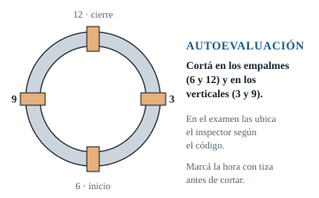
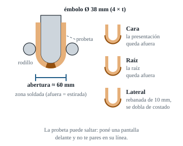
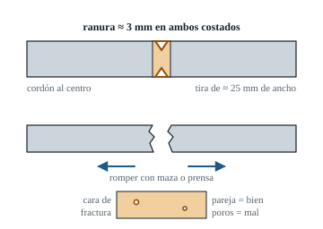

# 08 · Inspección y autoensayos en tu taller

**Un cupón lindo por fuera puede romperse en el doblado.** La falta de fusión no se ve. Por eso tenés que **romper tus propias probetas** con regularidad: es la única forma de saber si estás listo.

---

## 1. Inspección visual (lo primero, siempre)

> 📄 **En tus PDF:** curso M381, págs. 37 y 38: inspección visual. Págs. 38 a 44: tintas penetrantes, partículas magnéticas, radiografía y ultrasonido.

### Herramientas

- **Galga de filete** y **galga de soldadura multifunción** (tipo *Bridge Cam*), que mide sobremonta, socavación, desalineación y garganta.
- Linterna con **luz rasante** (de costado, casi paralela a la superficie): las socavaciones y los poros saltan a la vista.
- Lupa de 5×, espejo chico y regla.

### Checklist visual (criterios de referencia de AWS D1.1 ⚠️)

**Cara (presentación)**

- [ ] **Sin fisuras**
- [ ] **Cráteres llenos**
- [ ] **Sin golpes de arco** fuera de la junta
- [ ] **Socavación ≤ 1 mm** (1/32"). Medila con la galga en el punto más profundo
- [ ] **Sobremonta entre 0 y 3 mm** (1/8"), con transición suave
- [ ] Ancho parejo, cubriendo el borde del bisel más 1,5 mm por lado
- [ ] Sin porosidad superficial ni escoria visible
- [ ] Empalmes sin abultamientos ni huecos

**Raíz (por dentro)**

- [ ] **Penetración completa** en toda la vuelta, con los dos talones fundidos
- [ ] **Concavidad ≤ ~1,6–2 mm** (1/16")
- [ ] **Exceso de penetración ≤ 3 mm** (1/8")
- [ ] Sin agujeros, sin carámbanos y sin socavación interna

> Si el visual falla, **no tiene sentido cortar**: corregí primero lo visual.

---

## 2. Dónde cortar las probetas

- **En el examen:** las ubica el inspector según el código. Para 5G y 6G suelen tomarse en zonas a 45° entre las horas del reloj, cubriendo sobrecabeza, vertical y plano ⚠️ (ASME QW-463.2, figura de D1.1).
- **En tu práctica, sé más exigente:** cortá justo **en los empalmes de las 6 y de las 12**, y a las 3 y a las 9. Si los empalmes pasan, el resto también.

---

## 3. Preparación de la probeta de doblado

| Tipo | Cuándo | Dimensiones aproximadas ⚠️ |
|---|---|---|
| **Cara** (*face bend*) | Espesor < 10 mm (3/8") | Ancho ≈ 38 mm (1½") en caño > 4", o ≈ 19–25 mm en caño de 2"–4". Largo ≈ 150–200 mm. El espesor es el de la pared |
| **Raíz** (*root bend*) | Espesor < 10 mm | Ídem, pero se dobla con la raíz hacia afuera |
| **Lateral** (*side bend*) | Espesor ≥ 10 mm (por ejemplo, 6" Sch 80) | **Espesor de 10 mm** (es el corte). El ancho es el espesor de la pared |

**Pasos**

1. **Cortá** las tiras con disco de 1 mm, transversales a la soldadura, con el cordón centrado.
2. **Amolá al ras** la sobremonta y la penetración, por los **dos lados**, hasta la superficie del caño.
   - Las rayas del amolado tienen que ir **a lo largo** de la probeta, no a lo ancho. Las rayas transversales inician fisuras falsas.
   - **No te pases**: no adelgaces la probeta por debajo del espesor del caño.
3. **Redondeá los cantos** con lima o flap (radio ≤ 3 mm). Un canto vivo se fisura y te confunde.
4. **Marcá** de qué hora del reloj es y qué tipo de probeta es (cara, raíz o lateral).

---

## 4. Doblado guiado casero

### Dimensiones del dispositivo de referencia (acero tipo P-1 / A36, probeta de 10 mm) ⚠️ (ASME QW-466.1, D1.1)

- Para **probetas más finas que 10 mm**, el émbolo es de **4 × espesor** de diámetro (por ejemplo, para t = 6 mm, émbolo de unos 24 mm).
- Se dobla en **"U" a unos 180°**, hasta que la probeta pase entre los apoyos.

### Cómo armarlo con poco

- **Prensa hidráulica de taller** (marco en "H") con un **gato tipo botella de 20 t**. Soldá un **mandril de barra redonda de Ø 38 mm** a una planchuela que apoye en el gato, y armá un **dado de dos barras redondas** (o un bloque en U) con unos 60 mm de abertura.
- **Alternativa: doblador de envoltura** (*wrap-around*), aceptado en ASME. Es un mandril fijo de Ø 38 mm en la morsa, y la probeta se dobla alrededor con un caño largo como palanca, con un rodillo que la empuje.
- **Doblado en morsa con maza:** no es equivalente al ensayo, pero **sirve como indicador grosero**. Si se abre así, no va a pasar el ensayo real.

### Seguridad

- **La probeta puede salir disparada.** Poné una **pantalla o chapa** delante y **no te pares en la línea** de la probeta.
- Protección facial y guantes.

### Cómo leer el resultado

- **Aprobado** (ASME QW-163): ninguna abertura de más de **3 mm** en la soldadura o la ZAC.
- **D1.1:** ninguna abertura de más de 3 mm. La suma de las aberturas de entre 1 y 3 mm, como máximo 10 mm. Fisuras de esquina de hasta 6 mm (salvo que vengan de escoria o falta de fusión) ⚠️.
- Usá la tabla 3 del [capítulo 07](07-defectos-causas-soluciones.md) para diagnosticar **por qué** se abrió.

[Ver en YouTube: ensayo de doblado de probeta soldada](https://www.youtube.com/results?search_query=ensayo+de+doblado+probeta+soldadura)
[Ver en YouTube (inglés): guided bend test](https://www.youtube.com/results?search_query=guided+bend+test+weld+coupon)

---

## 5. Nick-break (rotura con entalla), estilo API 1104

Es el ensayo **más barato y más rápido** para ver el interior de la soldadura. Usalo aunque no te vayan a tomar API.

1. **Cortá** una tira transversal de **≈ 25 mm de ancho** y **≈ 200–230 mm de largo**, con el cordón centrado.
2. **Hacé una ranura** con el disco de 1 mm **en ambos costados** de la tira, en el centro del cordón, de **≈ 3 mm de profundidad**. Opcionalmente, ranurá también un poco la sobremonta.
3. **Romplo:** en la morsa, con maza, o en la prensa, haciendo palanca.
4. **Mirá la superficie de fractura** (la "cara" de la soldadura por dentro):
   - **Penetración y fusión completas**, sin talones ni paredes sin fundir.
   - **Poros:** ninguno mayor a **1,6 mm** (1/16"), y en total poca área ⚠️.
   - **Escoria:** inclusiones chicas y separadas (API fija límites de profundidad y largo) ⚠️.

> 💡 Una fractura **brillante y granulada** en toda la sección es buena señal. Las **zonas lisas, oscuras o con "escalones"** suelen ser falta de fusión o escoria.

[Ver en YouTube (inglés): nick break test](https://www.youtube.com/results?search_query=nick+break+test+API+1104)

---

## 6. Macroataque (opcional, pero muy instructivo)

Te permite **ver las pasadas, la penetración y las líneas de fusión** en un corte.

1. Cortá una **rodaja transversal** de la soldadura.
2. Planeá la cara con flap y después **lija al agua** en grano 80 → 120 → 240 → 400.
3. **Atacá** la superficie con:
   - **Persulfato de amonio** al 10–20 % en agua tibia (se vende para circuitos impresos), pasándolo con un algodón durante algunos minutos, **o**
   - **Nital** al 2–5 % (ácido nítrico en alcohol). Es más agresivo: **guantes, antiparras y ventilación**.
4. Enjuagá, secá y observá: vas a ver las **pasadas**, la **ZAC** y si **cada pasada se fundió con la pared y con la anterior**.

> ⚠️ Manejá los químicos con cuidado, lejos de chicos y alimentos, y descartalos según las indicaciones del producto.

[Ver en YouTube (inglés): macroataque de una soldadura](https://www.youtube.com/results?search_query=macro+etch+weld+test)

---

## 7. Planilla de autoevaluación por cupón

Copiala en tu cuaderno o en una hoja de cálculo.

| Ítem | Puntaje máximo | Criterio |
|---|---|---|
| Armado (luz, talón, hi-lo, posición) | 10 | Dentro de tolerancias en 4 puntos |
| Raíz por dentro | 20 | Penetración completa y pareja, sin concavidad ni carámbanos |
| Empalmes de raíz (6 y 12) | 10 | Sin falta de fusión ni hueco |
| Cara: socavación y sobremonta | 15 | ≤ 1 mm y ≤ 3 mm |
| Cara: aspecto y ancho | 5 | Parejo |
| Sin golpes de arco ni cráteres | 10 | Cero |
| **Doblado o nick-break** | **30** | Cada probeta aprobada suma; una sola que falla = 0 |
| **Total** | **100** | **Objetivo: ≥ 90 en 3 cupones seguidos antes del examen** |
